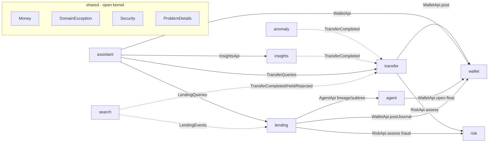
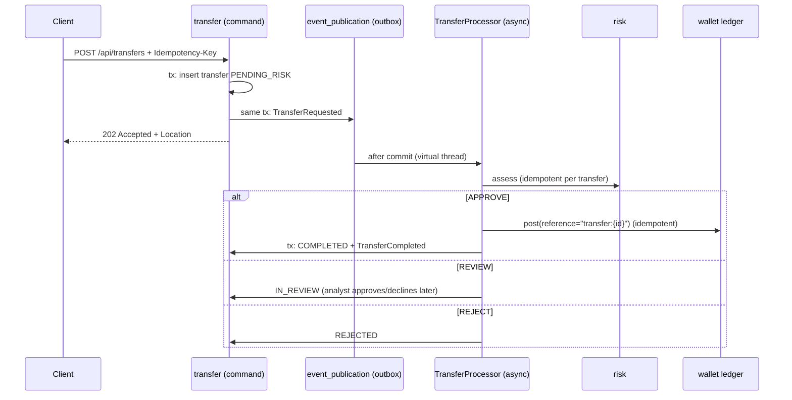
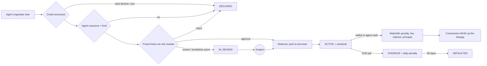

# KibetiPay architecture

Wallet + P2P transfers, an agent-network lending ecosystem (agents, sub-agents, loans, collections,
commissions), AI risk/credit scoring, anomaly detection, spending insights and a RAG support assistant. Built as a **modular monolith** (Spring Modulith): one deployable, hard module boundaries,
event-driven between modules, ready to split into services when there is a reason to.

## 1. Requirements

**Functional**
- Open a wallet (KES), deposit (simulated M-Pesa C2B), view balance and statement.
- Send money to another user by username. Duplicate requests must never move money twice.
- Every transfer is risk-scored before settlement: approve / hold for human review / reject.
- Detect unusual spending against each user's own baseline.
- Categorise spending and summarise it in plain language.
- Support assistant that answers policy questions (RAG) and account questions (tools).

**Non-functional**
- Correctness over availability for money: balances never negative, ledger always balanced.
- Exactly-once *effect* on top of at-least-once delivery (idempotency everywhere).
- AI is never on the critical path: model outage = degraded insights, never a failed payment.
- Observable: metrics, traces, structured events; auditable decisions.

## 2. Module map



Solid arrow = synchronous call through a public API interface. Dotted = listens to events.
No cycles; `ModularityTests` fails the build if that ever changes.

| Module | Owns (tables) | Public API | Notes |
|---|---|---|---|
| wallet | `wallet_account`, `wallet_journal`, `wallet_ledger_entry` | `WalletApi` | Double-entry ledger, pessimistic locks in id order |
| transfer | `transfer` | `TransferQueries`, `TransferEvents` | CQRS: command handler + async saga, JdbcClient queries |
| risk | `risk_assessment` | `RiskApi` | Deterministic rules decide; LLM only explains |
| anomaly | `anomaly_daily_outflow`, `anomaly_alert`, `anomaly_processed_transfer` | `AnomalyEvents` | Per-user z-score baseline |
| insights | `insight_transaction` | `InsightsApi` | Projection + batch LLM categorisation |
| assistant | `vector_store` (Spring AI) | REST only | RAG + read-only tools + chat memory |
| agent | `agent` | `AgentApi` | Agent → sub-agent tree, float wallets, recursive CTE lineage/subtree |
| mobilemoney | none yet | `MobileMoneyGateway` | Port for M-Pesa STK push / B2C; `@Fallback` simulator until Daraja is configured |
| lending | `lending_*` | `LendingQueries`, `LendingEvents` | Products, credit scorecard, approval saga, schedules, repayment waterfall, commissions, end-of-day job, PAR |
| search | OpenSearch indices `kibetipay-transfers`, `kibetipay-loans` (aliases → `-v1`) | REST only | Read model fed by events. Opt-in (`app.search.enabled`); see §9 |

## 3. The transfer saga



Why it survives crashes: each step is a local transaction and idempotent. If the JVM dies between
the ledger posting and the status update, the event publication stays incomplete, Spring Modulith
republishes it on restart, risk returns its stored decision, the ledger sees the reference already
exists and returns the original receipt, and the transfer is marked COMPLETED. No 2PC needed.

## 4. Ledger design (the part interviewers poke at)
- Amounts are `long` minor units + ISO currency. Never `double`.
- A **journal** = one business event; it owns ≥ 2 **entries**, and debits must equal credits
  (`Journal.assertBalanced`). Entries are append-only (`@Immutable`); corrections are reversal journals.
- `wallet_account.balance_minor` is a cached projection updated in the same transaction as the
  entries, with a DB `CHECK` constraint as a last line of defence against overdraft.
- Concurrency: `SELECT … FOR UPDATE` on both wallets **ordered by id** → no deadlocks when A→B and
  B→A run concurrently. `@Version` on aggregates for optimistic checks elsewhere.
- Idempotency at two levels: `transfer(initiator_id, idempotency_key)` unique and
  `wallet_journal.reference` unique.
- Deposits debit a `SYSTEM` float account, so total money in the system always sums to zero.
  Reconciliation query: `SELECT sum(CASE direction WHEN 'CREDIT' THEN amount_minor ELSE -amount_minor END) FROM wallet_ledger_entry` must be 0.

## 5. Lending ecosystem



| Money event | Journal legs (every journal balances) |
|---|---|
| Capital injection | float → lending pool |
| Disbursement | lending pool → borrower wallet |
| Repayment | payer (borrower wallet or agent float) → pool (principal) + interest income + fee income + penalty income |
| Commission | commission expense → originating agent + parent agent (largest-remainder split, no lost cents) |

Design decisions worth explaining in an interview:
- **Flat interest, schedule built at disbursement**, remainder cents on the last installment (`ScheduleCalculator`).
- **Waterfall** penalty → fee → interest → principal, oldest installment first (`RepaymentAllocator`), pure + unit-tested.
- **One open loan per borrower** enforced by a partial unique index, not only by code.
- **Loan ladder**: first loan capped; later loans up to 2× the largest repaid loan (`ScorecardCreditModel`).
- **Commission on collections, not disbursement**: agents earn when borrowers repay, which discourages reckless lending.
- **Agent exposure limit** checked before disbursement; sub-agent limit can never exceed its parent's.
- **End-of-day job** is run-once per business date (`lending_job_run`), re-runnable for a past date, and uses
  `@DynamicUpdate` so concurrent repayments cannot overwrite freshly accrued penalties.
- **PAR30** (portfolio at risk > 30 days) per agent subtree via recursive CTE: the health metric of a microfinance book.
- **Simplification to revisit:** loans receivable are tracked in the lending tables, not as ledger accounts. A full
  chart of accounts (assets/liabilities/income/expense with normal balances) is a good next step.

## 6. AI design principles
| Capability | Where | How | Failure mode |
|---|---|---|---|
| Credit scoring | `lending` | Transparent scorecard with reason codes + loan ladder; borderline → human | Deterministic, no LLM |
| Fraud/risk scoring | `risk` | Pluggable `RiskRule` beans, additive score, thresholds in config. LLM writes analyst notes for REVIEW/REJECT | LLM down → no note, decision unchanged |
| Anomaly detection | `anomaly` | Per-user daily outflow, z-score vs 90-day baseline, std-dev floor, 1 alert/day | Cold start (< 7 days) → skip |
| Spending insights | `insights` | Batch of 20 → one structured-output call → enum categories. SQL totals, LLM only narrates | Rows stay NULL, retried next run |
| Support assistant | `assistant` | `QuestionAnswerAdvisor` (pgvector) + `@Tool` methods bound to the caller + chat memory | No context → "I don't know" |

Swappable implementations use `@Fallback` beans (Spring Framework 6.2+): the safe default
(scorecard credit model, no-op risk explainer, M-Pesa simulator) is injected only when no "real"
bean is registered. This is a **startup** decision; **runtime** failures are still handled with
try/catch / resilience patterns, because bean wiring cannot react to a provider outage.

Guardrails: tools are read-only and per-user (no `ownerId` parameter the model could change); only
ids/amounts go to the risk model (no PII); `@ConcurrencyLimit` caps parallel model calls; LLM calls
never run inside a DB transaction.

## 7. Spring Boot features used
Spring Boot 4.1 · Java 25 virtual threads (no pinning on `synchronized`) + `ScopedValue` for the current user + compact object headers · Spring Modulith 2.1 (module verification, JDBC event
publication registry = outbox, `@ApplicationModuleListener`, actuator + observability, generated docs) ·
Spring AI 2.0 (ChatClient, advisors, structured output, tool calling, pgvector, chat memory) · Spring
Framework 7 resilience (`@ConcurrencyLimit`, `@EnableResilientMethods`) · `@ConfigurationProperties`
records + `@Validated` · profiles · Docker Compose support · Testcontainers `@ServiceConnection` ·
Flyway · ProblemDetail (RFC 9457) · Micrometer `@Observed` + Prometheus · Spring Security.

## 8. Roadmap (phased)
| Phase | Goal | You will learn |
|---|---|---|
| **1 · Core money + lending** (done in scaffold) | Wallets, ledger, transfers, agent network, loans, collections, commissions, EOD job | Double-entry, locking, outbox, CQRS, sagas, batch processing |
| **2 · Hardening** | Rate limiting (Bucket4j/Redis), reconciliation job, reversal journals, fees as extra ledger legs | Invariants, batch jobs, money edge cases |
| **3 · Integrations** | Real M-Pesa Daraja sandbox: STK push deposits + B2C withdrawals, webhook signature checks, retries | External APIs, webhooks, at-least-once |
| **4 · Security** | Keycloak / OAuth2 resource server (JWT), method security, audit log, secrets in Vault/Key Vault | AuthN/Z, threat modelling (STRIDE) |
| **5 · Real ML** | Train fraud + anomaly models (Python: XGBoost / Isolation Forest) on synthetic data, serve via ONNX in Java behind `RiskRule` | Feature engineering, model serving, drift |
| **6 · Scale-out** | `@Externalized` events to Kafka, read replica for queries, extract `risk` into its own service | When and how to split a monolith |
| **6b · Search** (started) | OpenSearch read model: full-text + facets for back office and users | Analyzers, mappings, bool queries, aggregations, scripted upserts, aliases/reindex |
| **7 · Ops** | Dockerfile/Buildpacks, k8s manifests, Grafana dashboards, SLOs, load tests (k6/Gatling) | Platform engineering, SRE |

## 9. Search (OpenSearch read model)

```
transfer / lending ──events──► event_publication (outbox) ──► search listeners ──► OpenSearch alias ──► /api/**/search/*
```

- **Never the source of truth.** Balances, ledger and idempotency stay in Postgres. The index lags by about 1s
  (refresh interval) and can be rebuilt from the database at any time.
- **Failure model.** Cluster down at startup: app still boots, indices are created on the first write.
  Cluster down at write time: `@Retryable` (3 tries), then the outbox keeps the event incomplete and republishes it
  on restart. Cluster down at read time: search endpoints return 503 `search_unavailable`; nothing else is affected.
- **Out-of-order / duplicate events** are handled in Painless scripted upserts: facts are reassigned, `status`
  only moves forward by rank, `updatedAt` only grows, repayments are de-duplicated by `repaymentId`.
- **Index versioning.** The app reads and writes an alias (`kibetipay-transfers`) with `require_alias=true`; the
  concrete index is `kibetipay-transfers-v1`. To change a mapping: add `transfers-v2.json`, bump the version,
  `_reindex` v1 → v2, then swap the alias atomically.
- **Per-user isolation** on the shared index is a `bool.filter` on `initiatorId`/`recipientId`, never on client input.

| Endpoint | Who | What |
|---|---|---|
| `GET /api/admin/search/transfers?q=&status=&party=&minAmount=&maxAmount=&from=&to=&page=&size=` | admin | full text + filters; facets: status counts, per-day histogram, amount stats |
| `GET /api/search/transfers?q=...` | any user | same, scoped to the caller |
| `GET /api/admin/search/loans?q=&status=&agentId=&borrower=` | admin | loans; facets: per-status count, principal and repaid sums |

Local tools: OpenSearch on `:9200`, OpenSearch Dashboards (Dev Tools console, Discover) on `:5601`.
